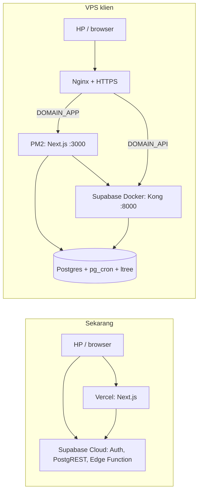

# Deploy ke VPS Klien

Panduan memindahkan Pantau Generus dari **Vercel + Supabase Cloud** ke **satu VPS** milik klien.
Untuk server resmi/uji yang sekarang (Vercel), lihat [DEPLOY.md](DEPLOY.md).

**Ringkasnya:** pakai **Supabase self-hosted (Docker) + Next.js (PM2) + Nginx** di satu VPS.
Cara ini **tidak mengubah kode sama sekali**: database, aturan akses (RLS), login, aplikasi
Android, dan Edge Function `admin-akun` tetap berjalan seperti di cloud.

## 1. Perubahan arsitektur



| Bagian | Sekarang | Di VPS |
|---|---|---|
| Aplikasi web | Vercel (serverless) | Next.js `next start` dikelola PM2 (2 proses) |
| Database | Supabase Cloud | Postgres di Docker Supabase, di VPS yang sama |
| Login & akun | Supabase Auth (cloud) | Supabase Auth (GoTrue) di Docker |
| API aplikasi Android | PostgREST + Edge Function (cloud) | PostgREST + edge-runtime di Docker |
| Penguncian presensi otomatis | pg_cron (cloud) | pg_cron (sudah ada di image Postgres Supabase) |
| HTTPS & domain | Otomatis dari Vercel | Nginx + Let's Encrypt (certbot) |
| Backup | Dashboard Supabase | `deploy/vps/backup.sh` via cron, **wajib disalin ke luar server** |

Yang berubah hanya **tempat** dan **isi environment** (alamat API, kunci, `DATABASE_URL`).

### Kenapa bukan PostgreSQL biasa / MySQL / shared hosting?

Aplikasi bergantung pada empat hal yang tidak ada di hosting biasa:

1. **Supabase Auth** untuk login, sesi cookie, buat akun, reset password, dan blokir akun
   (`src/lib/supabase/server.ts`, `src/proxy.ts`, `src/app/actions/auth.ts`, menu Akun).
2. **PostgreSQL dengan RLS, `ltree`, `pg_cron`**, dan fungsi `auth.uid()`. Semua aturan akses
   ada di database (`drizzle/*.sql`), jadi MySQL berarti menulis ulang seluruh aturan akses.
3. **PostgREST + Edge Function** untuk aplikasi Android.
4. **Node.js ≥ 22** yang berjalan terus. Shared hosting cPanel umumnya hanya PHP + MySQL.

| Pilihan | Ubah kode | Catatan |
|---|---|---|
| **A. Supabase self-hosted di VPS** (panduan ini) | Tidak ada | Butuh Docker, RAM ≥ 4 GB |
| B. PostgreSQL biasa + login buatan sendiri | ± 7–10 hari kerja | Lihat §9. Aplikasi Android ikut disesuaikan. |
| C. MySQL / shared hosting PHP | Tulis ulang besar | Tidak disarankan |

## 2. Spesifikasi & persiapan

| Skala | VPS |
|---|---|
| 1 daerah | 2 vCPU · 4 GB RAM · 60 GB SSD |
| 2 daerah, kegiatan bersamaan | **4 vCPU · 8 GB RAM · 80–100 GB NVMe** |

- OS: **Ubuntu 24.04 LTS**, data center Jakarta.
- Dua subdomain mengarah (DNS A record) ke IP VPS, misalnya:
  - `DOMAIN_APP` = `generus.domainklien.id` (aplikasi)
  - `DOMAIN_API` = `api.generus.domainklien.id` (login & API Android)
- Akses SSH dengan user biasa (bukan root) yang boleh `sudo`.

Contoh di bawah memakai folder `/srv/generus/{supabase,app,backup}`.

## 3. Pasang perangkat dasar

```bash
sudo apt update && sudo apt -y upgrade
sudo apt -y install git curl nginx certbot python3-certbot-nginx ufw
# Docker + compose plugin
curl -fsSL https://get.docker.com | sudo sh
sudo usermod -aG docker $USER   # keluar lalu masuk SSH lagi
# Node 22 + pnpm + PM2
curl -fsSL https://deb.nodesource.com/setup_22.x | sudo -E bash -
sudo apt -y install nodejs
sudo npm i -g corepack@latest pm2 && sudo corepack enable
# Swap 2 GB (aman saat `pnpm build`)
sudo fallocate -l 2G /swapfile && sudo chmod 600 /swapfile && sudo mkswap /swapfile && sudo swapon /swapfile
echo '/swapfile none swap sw 0 0' | sudo tee -a /etc/fstab
# Firewall: hanya SSH & web
sudo ufw allow OpenSSH && sudo ufw allow 'Nginx Full' && sudo ufw enable
sudo mkdir -p /srv/generus && sudo chown $USER /srv/generus
```

## 4. Supabase self-hosted

Ikuti juga panduan resmi: <https://supabase.com/docs/guides/self-hosting/docker>.

```bash
cd /srv/generus
git clone --depth 1 https://github.com/supabase/supabase supabase-src
cp -r supabase-src/docker supabase && rm -rf supabase-src
cd supabase && cp .env.example .env
```

Isi `.env` Supabase. Buat semua rahasia baru, jangan pakai contoh. Kunci `ANON_KEY` dan
`SERVICE_ROLE_KEY` dibuat dari `JWT_SECRET`: jalankan `sh ./utils/generate-keys.sh` bila
tersedia, atau ikuti bagian *Generate API keys* di panduan resmi.

| Variabel | Isi |
|---|---|
| `POSTGRES_PASSWORD` | password kuat (huruf & angka, hindari `@:/?#`) |
| `JWT_SECRET`, `ANON_KEY`, `SERVICE_ROLE_KEY` | hasil generate, disimpan aman |
| `DASHBOARD_USERNAME`, `DASHBOARD_PASSWORD` | login Studio |
| `POOLER_TENANT_ID` | mis. `generus` |
| `SITE_URL` | `https://DOMAIN_APP` |
| `API_EXTERNAL_URL`, `SUPABASE_PUBLIC_URL` | `https://DOMAIN_API` |
| `DISABLE_SIGNUP` | `true` (akun hanya dibuat superadmin) |
| `ENABLE_EMAIL_AUTOCONFIRM` | `true` |

**Penting — Docker melewati firewall `ufw`.** Di `docker-compose.yml`, ubah port yang dibuka
ke luar agar hanya terdengar di `127.0.0.1`:

```yaml
# service kong
ports:
  - 127.0.0.1:${KONG_HTTP_PORT}:8000/tcp
  - 127.0.0.1:${KONG_HTTPS_PORT}:8443/tcp
# service supavisor
ports:
  - 127.0.0.1:${POSTGRES_PORT}:5432
  - 127.0.0.1:${POOLER_PROXY_PORT_TRANSACTION}:6543
```

Pasang Edge Function `admin-akun` (dipakai aplikasi Android), lalu jalankan:

```bash
mkdir -p volumes/functions/admin-akun
# setelah repo aplikasi di-clone (langkah 5), salin fungsinya:
#   cp /srv/generus/app/supabase/functions/admin-akun/index.ts volumes/functions/admin-akun/
docker compose pull
docker compose up -d
docker compose ps   # semua "healthy"
```

Studio (dashboard) **tidak dibuka ke publik**. Akses lewat tunnel SSH dari komputer admin:
`ssh -L 8000:127.0.0.1:8000 user@IP_VPS`, lalu buka `http://localhost:8000`.

Aplikasi tidak memakai Storage dan Realtime. Service itu boleh dimatikan untuk menghemat RAM
setelah semuanya berjalan, tetapi uji dulu karena beberapa service saling bergantung.

## 5. Aplikasi Next.js

```bash
cd /srv/generus
git clone https://github.com/OWNER/generus.git app
cd app
cp deploy/vps/env.production.example .env.production.local
nano .env.production.local     # isi DOMAIN_API, kunci dari .env Supabase, password DB, admin awal
pnpm install --frozen-lockfile
```

Siapkan database (urutan wajib):

```bash
# 1) tabel, fungsi, RLS
node scripts/with-env.mjs .env.production.local pnpm exec drizzle-kit migrate
# 2) jadwal penguncian presensi tiap 15 menit (pg_cron)
node scripts/with-env.mjs .env.production.local pnpm exec tsx scripts/db-cron.ts
# 3) daerah pertama + akun superadmin sistem
node scripts/with-env.mjs .env.production.local pnpm exec tsx scripts/setup-awal.ts --daerah "Klaten Timur 1"
# 4) cek
node scripts/with-env.mjs .env.production.local pnpm exec tsx scripts/db-check.ts
```

Salin Edge Function ke Supabase (langkah 4), lalu build dan jalankan:

```bash
cp supabase/functions/admin-akun/index.ts /srv/generus/supabase/volumes/functions/admin-akun/
(cd /srv/generus/supabase && docker compose restart functions)

pnpm build
pm2 start deploy/vps/ecosystem.config.cjs
pm2 save && pm2 startup   # jalankan perintah yang dicetak agar hidup lagi setelah reboot
```

Setelah login pertama, hapus `SETUP_ADMIN_PASSWORD` dari `.env.production.local`.

## 6. Nginx & HTTPS

```bash
sudo cp deploy/vps/nginx.conf /etc/nginx/sites-available/generus
sudo sed -i 's/DOMAIN_APP/generus.domainklien.id/; s/DOMAIN_API/api.generus.domainklien.id/' /etc/nginx/sites-available/generus
sudo ln -s /etc/nginx/sites-available/generus /etc/nginx/sites-enabled/
sudo nginx -t && sudo systemctl reload nginx
sudo certbot --nginx -d generus.domainklien.id -d api.generus.domainklien.id
```

HTTPS wajib: tanpa HTTPS aplikasi tidak bisa dipasang di HP dan kamera pemindai QR tidak jalan.

## 7. Backup

```bash
mkdir -p /srv/generus/backup
chmod +x /srv/generus/app/deploy/vps/backup.sh
crontab -e
# tambahkan:
30 1 * * * /srv/generus/app/deploy/vps/backup.sh >> /srv/generus/backup/backup.log 2>&1
```

Backup yang hanya ada di VPS ikut hilang bila VPS rusak. Salin ke luar server, misalnya dengan
`rclone` ke Google Drive (baris contoh ada di `backup.sh`). Uji pemulihan sekali sebelum serah terima.

## 8. Operasional

**Memperbarui aplikasi** (mis. setelah perbaikan dari developer):

```bash
cd /srv/generus/app
git pull
pnpm install --frozen-lockfile
node scripts/with-env.mjs .env.production.local pnpm exec drizzle-kit migrate
pnpm build && pm2 reload generus
# bila supabase/functions/admin-akun berubah:
cp supabase/functions/admin-akun/index.ts /srv/generus/supabase/volumes/functions/admin-akun/
(cd /srv/generus/supabase && docker compose restart functions)
```

**Aplikasi Android** harus di-build ulang dengan alamat `https://DOMAIN_API` dan `ANON_KEY` baru.

**Menambah superadmin sistem:**
`node scripts/with-env.mjs .env.production.local pnpm exec tsx scripts/system-admin.ts email@...`

**Memantau:** `pm2 status`, `pm2 logs generus`, `docker compose ps` (di `/srv/generus/supabase`),
`df -h` (sisa disk). Untuk peringatan saat server mati, pasang mis. Uptime Kuma.

**Pindah data dari Supabase Cloud** (hanya bila klien memakai data yang sudah ada; untuk
klien baru lewati): jalankan migrasi di VPS, lalu ambil isi skema `auth` dan `public` dari cloud
dengan `pg_dump --data-only --schema=auth --schema=public`. Pulihkan sebagai `supabase_admin`
dengan `SET session_replication_role = replica;` agar trigger tidak membuat baris ganda.
Uji dulu di VPS percobaan. Akun lama tetap bisa login asal `JWT_SECRET` baru dipakai untuk
sesi baru; semua pengguna cukup login ulang.

### Troubleshooting

| Gejala | Penyebab umum |
|---|---|
| Login berputar kembali ke /login | `NEXT_PUBLIC_SUPABASE_URL`/`ANON_KEY` salah, atau `SITE_URL` Supabase tidak sama dengan domain aplikasi. Ingat: `NEXT_PUBLIC_*` butuh `pnpm build` ulang. |
| 502 Bad Gateway | PM2 mati (`pm2 logs generus`) atau Kong belum hidup (`docker compose ps`). |
| `password authentication failed` | User `DATABASE_URL` harus `postgres.<POOLER_TENANT_ID>` bila lewat Supavisor. |
| Presensi tidak terkunci otomatis | Jadwal pg_cron belum dipasang: ulangi `scripts/db-cron.ts`. |
| Menu Akun error saat membuat akun | `SUPABASE_SERVICE_ROLE_KEY` salah atau GoTrue tidak jalan. |

## 9. Pilihan B: PostgreSQL biasa tanpa Supabase

Hanya bila Docker tidak bisa dipakai. Perkiraan kerja **7–10 hari**:

- **Skema `auth` minimal**: tabel `auth.users`, fungsi `auth.uid()` yang membaca
  `request.jwt.claim.sub`, role `authenticated`/`anon`. Contohnya sudah ada di
  `tests/db/harness.ts`. `withRls()` sudah mengisi klaim, jadi seluruh RLS tetap berlaku.
- **Login sendiri**: hash password (bcrypt/argon2), sesi cookie bertanda tangan, pengganti
  `getClaims()` di `src/proxy.ts` dan `src/lib/auth.ts`, serta login/logout/ganti password
  (`src/app/actions/auth.ts`).
- **Operasi admin akun** di `src/app/(app)/admin/akun/actions.ts` diganti query langsung
  (buat akun, reset password, blokir) tanpa `createSupabaseAdmin()`.
- **Aplikasi Android** tidak bisa lagi memakai PostgREST/Edge Function. Perlu API sendiri,
  atau PostgREST dipasang terpisah dengan JWT buatan sendiri.
- Penguncian presensi: `pg_cron` dipasang di PostgreSQL VPS, atau cron sistem memanggil
  `SELECT app.lock_due_agendas()` setiap 15 menit.

## 10. Checklist serah terima

- [ ] `https://DOMAIN_APP` terbuka dengan gembok HTTPS, bisa dipasang di HP.
- [ ] Login superadmin sistem → menu Wilayah menampilkan **Tambah daerah**.
- [ ] Buat desa, kelompok, akun admin kelompok, lalu login sebagai akun itu.
- [ ] Buat agenda, isi presensi di HP, matikan internet → isi → nyalakan → tersinkron.
- [ ] Pindai QR dari kartu cetak di HP (kamera jalan).
- [ ] Tunggu agenda lewat batas waktu → terkunci otomatis (pg_cron).
- [ ] `backup.sh` menghasilkan file, dan file tersalin ke luar server.
- [ ] Reboot VPS → aplikasi & Supabase hidup sendiri (`pm2 startup`, Docker `restart: unless-stopped`).
- [ ] Serahkan ke klien: alamat, akun superadmin, lokasi backup, dan file `.env` Supabase (disimpan aman).
